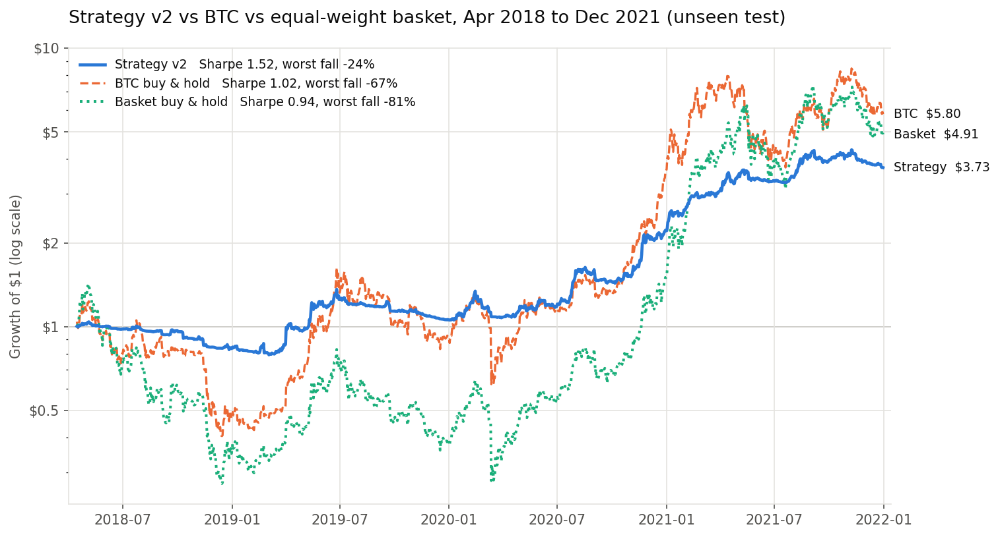
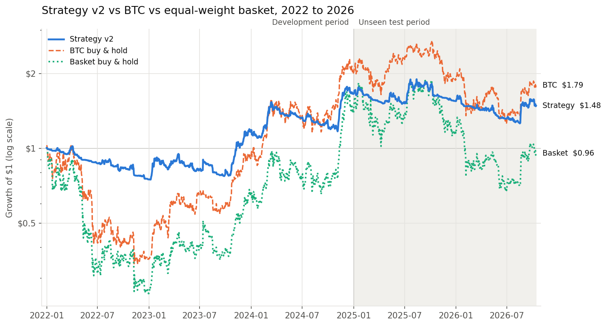

# Python Scripts: Quant and Physics

Python scripts for learning and teaching topics in quantitative finance and physics.
The main project is a crypto trading strategy taken from a first idea, through an
audit that showed its edge was luck, to a redesigned strategy tested on data it never saw.

Backtests run on the TWSQ framework with Kraken's fees
(0.26% taker, 0.16% maker) and 0.1% slippage. Benchmarks: BTC buy & hold and an
equal-weight buy & hold basket of the same coins.

## Results at a glance

| Period | Role | Strategy v2 Sharpe | BTC Sharpe | v2 worst fall | BTC worst fall |
|---|---|---|---|---|---|
| Apr 2018 – Dec 2021 | Unseen test | **1.52** | 1.02 | −24% | −67% |
| 2022 – 2024 | Development | 0.87 | 0.70 | −27% | −67% |
| 2025 – Oct 2026 | Unseen test | −0.20 | **0.07** | −34% | −53% |

v2 beat BTC on risk-adjusted return in two of three periods, including one it never saw
during development, and its worst fall was well below BTC's in all three. Its edge is
regime-dependent: strong in trending markets (2020–21 Sharpe 2.43 vs 1.61), roughly level
in the 2018–19 bear market (0.26 vs 0.24), and negative in choppy 2025–26.




## Strategy v1: walk-forward momentum (retired)

At each monthly rebalance, v1 picked for each coin the lookback window (7–90 days) with
the best trailing Sharpe ratio, went long if that window's return was positive, sized
positions by inverse volatility, and used a 15% trailing stop.

Its first backtest beat BTC (Sharpe 0.55 vs 0.47, 2022–2026). An audit found:

1. **The stop-loss never fired.** The peak price was only stored on a new high, and an
   unset peak defaulted to today's price, so the drop was always measured from itself.
   Fixing it fired the stop 75 times and cut the Sharpe to 0.44.
2. **The edge was luck.** A sweep of 20 nearby settings (rebalance every 20–40 days, two
   window-scoring methods) beat BTC in only 2 of 20 runs; median Sharpe 0.22 vs BTC 0.47.
   Rebalancing every 30 days instead of 31 halved the Sharpe.

## Strategy v2: ensemble trend with volatility targeting

Each design choice targets a weakness the v1 audit exposed:

| v1 weakness | v2 design |
|---|---|
| Picking the "best" lookback chases noise | Trend strength = share of all six lookbacks with a positive return |
| Results hinged on which calendar day it rebalanced | Checks daily; trades only when a position drifts more than 10% from target |
| Fixed $100k bets kept going after losses | Sized from current equity; total exposure capped at 100% (no leverage) |
| The stop sold ordinary dips and missed rebounds | No stop; each coin scaled to a 40% volatility target over a 30-day window |

**Research discipline.** Settings were declared before testing (10% band, 30-day
volatility window). Development used 2022–2024 only, where 10 of 12 nearby settings beat
BTC (median Sharpe 0.89 vs 0.70). The settings were then frozen and tested once on each
unseen period. Results above are reported whether they passed or not.

**Honest limits.** Nine years of data on five correlated coins is not enough to prove an
edge: a Sharpe estimate over two years is uncertain by roughly ±0.7. The robust finding is
the risk reduction; the return edge depends on the market regime.

## Files

| File | What it does |
|---|---|
| `v2_trend_research.py` | v2 strategy, 2022–24 robustness grid, one-time 2025–26 test, growth chart |
| `v2_trend_test_2018_2021.py` | Frozen v2 tested on Apr 2018 – Dec 2021, with PASS/FAIL and chart |
| `v2_trend_live_trader.py` | v2 live on Kraken; same code as the backtest, starts in dry-run mode |
| `v1_momentum_backtest.py` | v1 strategy backtest and report |
| `v1_audit_fix_by_fix.py` | v1 audit: effect of each fix, one at a time |
| `v1_audit_parameter_sweep.py` | v1 audit: 20-setting sweep |
| `v1_momentum_live_trader.py` | v1 live trader (retired) |
| `performance_report.py` | Shared date alignment and performance statistics |
| `4DSceneTest.py`, `dot_to_geo_animations.py` | Manim physics and geometric algebra animations |

## Reproducing the results

Keep all files in one folder, with `twsq`, `yfinance`, `pandas`, `numpy` and `matplotlib`
installed, then run:

```
python v2_trend_test_2018_2021.py     # unseen 2018-21 test (~20 s)
python v2_trend_research.py           # 2022-24 grid + unseen 2025-26 test (~3 min)
python v1_audit_fix_by_fix.py         # v1 audit (~1 min)
python v1_audit_parameter_sweep.py    # v1 sweep (~4 min)
```

Note: TWSQ dates each day's PnL with the following day's date; the reports shift it back
one day (found with a lag-correlation test) so the strategy and benchmarks line up.
